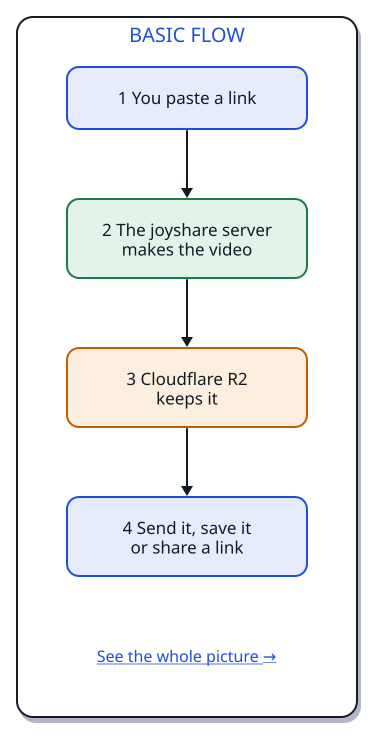
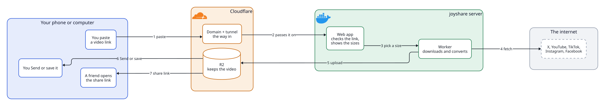
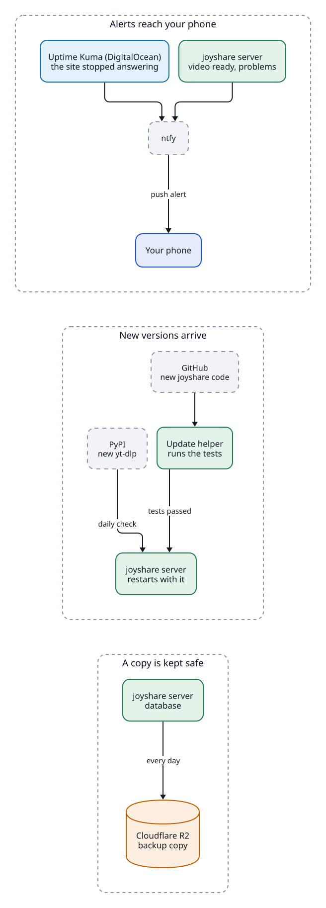

# a-vid-share-app

**Share the video, not the app.**

Ever wanted to send a friend a video, but they don't have an account on X, TikTok, Instagram or wherever you found it?
Ever seen something in your feed you wanted to keep on your own device before it disappears?

joyshare is a small private web app you run yourself: on your own computer, a Raspberry Pi, a cloud server, or anywhere else that runs Docker. Paste a link, get a video file you can send anywhere.

> **Status: in daily use.** Everything below works today, running on its own server and reachable on its own domain. What's left is on the [pending list](docs/PENDING.md).

## How it works

<a href="docs/INFOGRAPHIC.md" title="joyshare at a glance: the whole picture"></a>

1. **Paste a link** from X (Twitter), YouTube, TikTok, Instagram or Facebook. On an iPhone you can send it straight from the share sheet.
2. **Pick a size.** joyshare shows how big the file will be before you commit: best quality (up to 1080p), 720p, 480p, shrunk to fit a size you pick, or audio only. Or cut just a clip.
3. **Watch something fun** while it works. Progress is a small 3D scene: a tower being demolished, a rocket launch, a black hole, a cow meeting a flying saucer, falling dominoes. Calmer scenes play when your device asks for reduced motion.
4. **Send it.** Share it to WhatsApp or iMessage, download it, or copy a link your friend can open in any browser. No account needed on their side.

<br clear="right">

## Quick facts

| | |
|---|---|
| **Runs on** | Wherever Docker runs: a Mac, a Linux box, a Raspberry Pi (64-bit, not tested yet) or a cloud server. Moving between them is a guided job. |
| **Works from** | iPhone, Android, Mac, Windows. Anything with a browser. |
| **Sign-in** | Face ID / Touch ID (passkeys). No passwords. Only devices you approve get in. |
| **Share links** | Expire after 48 hours. |
| **Clips** | Share just a part of a video: give a start and an end, or tap while watching. |
| **Files** | Deleted automatically (after 48 hours by default). Nothing piles up. Videos can be kept on the computer's own disk or in Cloudflare R2. |
| **Updates** | Optional: the computer checks GitHub on a schedule you pick, or when you press Update in the admin panel, runs the tests and only then puts the new code live. yt-dlp updates itself daily, with a self-test and rollback. |
| **Size limit** | 200 MB per video by default. You can change it. |
| **Output** | MP4 that plays in iMessage, WhatsApp and every browser. M4A for audio. |
| **Alerts** | Push notifications to your phone ([ntfy](https://ntfy.sh)) when a video is ready or something breaks, including a daily check that each platform still works. |
| **Admin panel** | Stats, videos, share links, people, limits, alerts, storage, backups, updates and an activity log in one place. Admins can also use the app as a regular member to see what others see. |
| **Backups** | The database is backed up every day, to the computer and to R2 when it's set up. One command packs everything up to move or restore. |
| **Make it yours** | English and Spanish, eleven looks and a choice of lettering, per person. |
| **Powered by** | [yt-dlp](https://github.com/yt-dlp/yt-dlp), ffmpeg, FastAPI, SQLite, Three.js, plain JavaScript |

## How it fits together

**How a video gets to you**, step by step:

<p align="center"></p>

Videos never travel back through the tunnel: the worker puts each finished file in R2, and phones and friends download it from there.

**What keeps it running**: alerts, updates and backups.

<p align="center"></p>

Both diagrams are drawn with [D2](https://d2lang.com) from [docs/architecture-flow.d2](docs/architecture-flow.d2) and [docs/architecture-upkeep.d2](docs/architecture-upkeep.d2); after a change, render them again with the command at the top of each file.

## What you need

- Somewhere that stays on, with **Docker** installed: a spare Mac or PC, a Raspberry Pi, or a small cloud server
- To use it from anywhere: a **domain name** (about $10–15 a year), plus either a free **Cloudflare** account (reachable from anywhere without opening ports on your router) or, on a cloud server, the built-in Caddy web server
- Optional: the free **ntfy** app on your phone for alerts

**Your own connection or the cloud?** A computer on your own internet connection is the easiest choice for downloading: platforms, YouTube most of all, often block the addresses of cloud providers. A cloud server works too, and the [Linux guide](docs/MOVING-LINUX.md) explains how to deal with that.

## Setting it up

To try it on your own computer:

```bash
git clone https://github.com/arielrivera/joyshare.git
```

```bash
cd joyshare && ./joyshare update
```

Then open http://localhost:8080, register your device with the setup code (`./joyshare setup-code` shows one), and paste a link. `./joyshare` with nothing after it lists every command.

The full walkthrough is in the [setup guide](docs/SETUP.md).

## Dig deeper

- **[Setup guide](docs/SETUP.md)**: running it, registering devices, inviting people, the iPhone Shortcut
- **[Troubleshooting](docs/TROUBLESHOOTING.md)**: the site is down, after a restart, what each alert means, videos, sign-in, updates, putting data back
- **[Cloudflare R2 guide](docs/R2.md)**: serving videos from R2, step by step
- **[Uptime Kuma guide](docs/UPTIME-KUMA.md)**: a watcher on a small cloud server that alerts you when joyshare is down, with one script to set it up and keep it running
- **[What's pending](docs/PENDING.md)**: a short summary of everything left
- **[Roadmap](docs/ROADMAP.md)**: what is built, what is left, and how to continue
- **Moving guides**: [to another Mac](docs/MOVING-MAC.md) and [to a Linux server](docs/MOVING-LINUX.md) (written for a cloud server; most steps apply to a Linux box or Raspberry Pi on your own network too), with or without Cloudflare, and what happens if the old computer is left running
- **[joyshare at a glance](docs/INFOGRAPHIC.md)**: one page with the process, where each part runs, the diagrams, how long things are kept and the stack
- **How it's built**: the project plan (`docs/proposal.html`)

## Fair use

joyshare is for personal use: saving things that matter to you and sharing them with people you know. Respect the platforms' terms and the rights of the people who made the videos. Give credit where you can.
